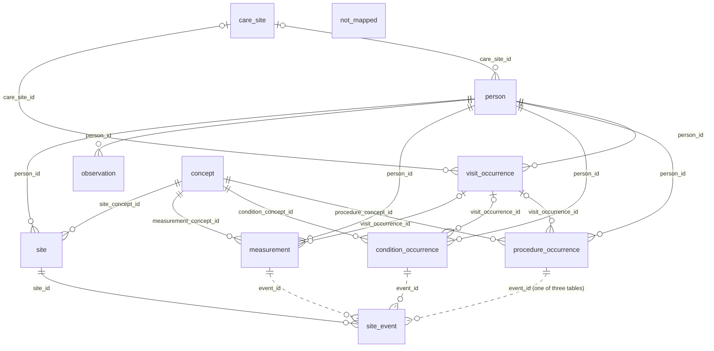

# Silver data models (spec 029)

Generated from [`_build/opendental_silver_model.py`](../_build/opendental_silver_model.py) and [`_build/omop_silver_model.py`](../_build/omop_silver_model.py) by `_build/silver_erd.py`, with the gold ERDs' writer; `python/tests/test_silver_erd.py` checks them. Keys are logical. The draw.io and Mermaid sources are in `source/`. Synthetic data only.

## Open Dental silver: `health_transformation_lab.silver_opendental_perio`

The cleaned Open Dental tables spec 029 reads, with Open Dental's own names lowercased ([research](../../specs/029-tooth-loss/research.md)), the tables derived from them, and the evaluation-only answer key. Dashed lines are matches, not keys: `proctp.dx` is text matched to a diagnosis by name, and a planned procedure's copies point back with `procnumorig`.

Draw.io: [entity](source/opendental_silver_entity.drawio) · [full](source/opendental_silver_full.drawio) · [data dictionary](source/opendental_silver_dictionary.drawio) (subject areas, row counts, nulls, distinct and top values)

```mermaid
erDiagram
    clinic |o--o{ patient : "clinicnum"
    clinic |o--o{ procedurelog : "clinicnum"
    patient ||--o{ procedurelog : "patnum"
    procedurecode ||--o{ procedurelog : "codenum"
    definition |o--o{ procedurelog : "dx = defnum (diagnosis list)"
    patient ||--o{ treatplan : "patnum"
    treatplan ||--o{ proctp : "treatplannum"
    procedurelog ||--o{ proctp : "procnumorig: one procedure, many copies"
    definition |o..o{ proctp : "dx text = itemname (name, not a key)"
    patient ||--o{ perioexam : "patnum"
    perioexam ||--o{ periomeasure : "perioexamnum"
    patient ||--o{ toothinitial : "patnum"
    patient ||--o{ disease : "patnum"
    diseasedef ||--o{ disease : "diseasedefnum"
    patient ||--o{ appointment : "patnum"
    provider ||--o{ appointment : "provnum"
    clinic |o--o{ appointment : "clinicnum"
    provider ||--o{ procedurelog : "provnum"
    patient ||--o{ medicationpat : "patnum"
    medication ||--o{ medicationpat : "medicationnum"
    patient ||--o{ allergy : "patnum"
    allergydef ||--o{ allergy : "allergydefnum"
    medication |o--o{ allergydef : "medicationnum"
    patient ||--o{ sheet : "patnum"
    sheet ||--o{ sheetfield : "sheetnum"
    patient ||--o{ vitalsign : "patnum"
    patient ||--o{ patientrace : "patnum"
    cdcrec ||--o{ patientrace : "cdcreccode"
    site |o--o{ patient : "sitenum"
    procedurelog ||--o{ procnote : "procnum"
    patient ||--o{ document : "patnum"
    definition ||--o{ document : "defnum = doccategory (category 18)"
    document ||--o{ radiograph_bone_level : "docnum = document_id (ImgType 1)"
    patient ||--o{ ehrmeasureevent : "patnum"
    snomed |o..o{ ehrmeasureevent : "codevalueresult = snomedcode"
    patient ||--o{ patfield : "patnum"
    patient ||--o{ patient_tooth : "patnum = patient_id"
    procedurelog ||--o| planned_extraction : "procnum = procedure_id (procstatus 1)"
    planned_extraction }o..o| patient_tooth : "labels planned teeth"
    periomeasure }o..o| patient_tooth : "measures before the loss"
    patient_tooth ||..o| tooth_loss_truth : "scored against (evaluation only)"
    proctp }o..o{ tooth_loss_dq_check : "copies checked against the original"
    patient
    clinic
    procedurelog
    procedurecode
    treatplan
    proctp
    definition
    perioexam
    periomeasure
    toothinitial
    disease
    diseasedef
    provider
    appointment
    medication
    medicationpat
    allergy
    allergydef
    sheet
    sheetfield
    vitalsign
    patientrace
    cdcrec
    site
    procnote
    document
    ehrmeasureevent
    patfield
    snomed
    patient_tooth
    radiograph_bone_level
    planned_extraction
    tooth_loss_dq_check
    tooth_loss_truth
```

### `patient`

One per patient. tooth_loss_load: overwrite per run.

| Key | Column | Type | Description |
|---|---|---|---|
| PK | `patnum` | bigint | Open Dental patient key |
|  | `birthdate` | date | age is computed from this, never stored |
|  | `gender` | int | PatientGender enum |
|  | `patstatus` | int | PatientStatus enum |
| FK | `clinicnum` | bigint | the office; 0 when the practice uses no clinics |
|  | `priprov` | bigint | primary provider |
|  | `datefirstvisit` | date | set by the software |
|  | `smokingsnomed` | string | latest smoking status, SNOMED code |
|  | `zip` | string | postcode; a real extract keeps at most the first 3 digits |
| FK | `guarantor` | bigint | head of household (patient.patnum) |
|  | `medurgnote` | string | free-text medical alert |
|  | `premed` | boolean | needs premedication before appointments |
|  | `language` | string | primary language code |
|  | `admitdate` | date | hospital admission date; can precede the first visit |
|  | `sitenum` | bigint | place of care (school, nursing home); 0 when none |
| FK | `responsparty` | bigint | responsible for finances (patient.patnum) |
|  | `datetimedeceased` | timestamp | date of death |

### `clinic`

One per office. tooth_loss_load: overwrite per run.

| Key | Column | Type | Description |
|---|---|---|---|
| PK | `clinicnum` | bigint | office key |
|  | `description` | string | office name (synthetic) |
|  | `abbr` | string | short name |
|  | `address` | string | street address |
|  | `address2` | string | second address line |
|  | `city` | string | city |
|  | `state` | string | state |
|  | `zip` | string | postcode |
|  | `phone` | string | phone |
|  | `fax` | string | fax |

### `procedurelog`

One per procedure, done or planned: the one record of each. tooth_loss_load: overwrite per run.

| Key | Column | Type | Description |
|---|---|---|---|
| PK | `procnum` | bigint | procedure key |
| FK | `patnum` | bigint | patient |
|  | `procstatus` | int | 1 planned (TP) · 2 complete · 4 existing, other provider · 6 deleted · ... |
|  | `procdate` | date | date shown as performed; planned: date planned or empty |
|  | `datetp` | date | when first planned |
|  | `datecomplete` | date | when set complete |
| FK | `codenum` | bigint | the procedure code (key, not text) |
|  | `toothnum` | string | 1–32, A–T primary; blank for mouth-level |
|  | `surf` | string | surfaces, quadrant, sextant or arch |
| FK | `dx` | bigint | diagnosis: an item in the practice's own list (definition, category Diagnosis) |
| FK | `prognosis` | bigint | prognosis item (definition, category Prognosis) |
|  | `diagnosticcode` | string | ICD code, only when sent with a medical claim; rare; a check, never the label |
|  | `icdversion` | int | 9 or 10: which ICD diagnosticcode is |
|  | `provnum` | bigint | provider |
| FK | `clinicnum` | bigint | office |
|  | `aptnum` | bigint | the appointment |
|  | `procfee` | double | fee |
|  | `toothrange` | string | teeth of a multi-tooth procedure, comma-separated |
| FK | `priority` | bigint | treatment priority (definition) |
|  | `placeservice` | int | where it was done: office, school, nursing facility, mobile unit, ... |
|  | `prosthesis` | string | blank no · I initial · R replacement |
|  | `medicalcode` | string | optional medical procedure code |
|  | `unitqty` | int | units billed, 1 by default |
|  | `sitenum` | bigint | place of care |

### `procedurecode`

One per procedure code: fixed meaning (CDT D-codes). tooth_loss_load: overwrite per run.

| Key | Column | Type | Description |
|---|---|---|---|
| PK | `codenum` | bigint | code key |
|  | `proccode` | string | the D-code; extractions D7140, D7210 |
|  | `descript` | string | standard description |
|  | `abbrdesc` | string | abbreviation |
|  | `treatarea` | int | tooth · surface · quadrant · arch · mouth |
| FK | `proccat` | bigint | procedure category (definition) |
|  | `isprosth` | boolean | crown, bridge, denture or partial |
|  | `ishygiene` | boolean | a hygiene procedure |
|  | `medicalcode` | string | a matching medical code, optional |
|  | `isradiology` | boolean | a radiology procedure |

### `treatplan`

One per saved treatment plan; several can share a date (alternatives). tooth_loss_load: overwrite per run.

| Key | Column | Type | Description |
|---|---|---|---|
| PK | `treatplannum` | bigint | plan key |
| FK | `patnum` | bigint | patient |
|  | `datetp` | date | date of the plan |
|  | `tpstatus` | int | 0 saved · 1 active · 2 inactive |
|  | `signature` | string | captured when the plan is signed; empty when unsigned |

### `proctp`

One per planned procedure per saved plan: a copy, repeated in every plan and at later exams. tooth_loss_load: overwrite per run.

| Key | Column | Type | Description |
|---|---|---|---|
| PK | `proctpnum` | bigint | copy key |
| FK | `treatplannum` | bigint | the plan it was copied into |
| FK | `patnum` | bigint | patient |
| FK | `procnumorig` | bigint | the procedurelog row it copies: count planned procedures there, not here |
|  | `toothnumtp` | string | tooth, as display text: can differ from the original |
|  | `proccode` | string | code as text, not a key: editable, can differ from procedurecode |
|  | `descript` | string | description as text: editable |
|  | `dx` | string | diagnosis as text (the item's name when saved), not a key: matched by name |
|  | `prognosis` | string | prognosis as text |
|  | `itemorder` | int | order within the plan, fixed when saved |
| FK | `priority` | bigint | treatment priority (definition) |
|  | `surf` | string | surfaces, quadrant or arch, as text |
|  | `procabbr` | string | code abbreviation as text; editable |
|  | `provnum` | bigint | provider |
|  | `datetp` | date | date planned |
| FK | `clinicnum` | bigint | office |

### `definition`

One per item in the practice's own lists (diagnoses, prognoses, ...). tooth_loss_load: overwrite per run.

| Key | Column | Type | Description |
|---|---|---|---|
| PK | `defnum` | bigint | item key |
|  | `category` | int | which list: Diagnosis, Prognosis, ... |
|  | `itemname` | string | the item's text, e.g. a diagnosis; older and newer lists both stay |
|  | `itemvalue` | string | extra information, used differently per list |
|  | `itemorder` | int | place in the list, from 0 |
|  | `ishidden` | boolean | hidden: retired items keep their keys |

### `perioexam`

One per periodontal exam. tooth_loss_load: overwrite per run.

| Key | Column | Type | Description |
|---|---|---|---|
| PK | `perioexamnum` | bigint | exam key |
| FK | `patnum` | bigint | patient |
|  | `examdate` | date | exam date |
|  | `provnum` | bigint | examining provider |

### `periomeasure`

One per exam, tooth and kind of measure (six sites as columns). tooth_loss_load: overwrite per run.

| Key | Column | Type | Description |
|---|---|---|---|
| PK | `periomeasurenum` | bigint | measure key |
| FK | `perioexamnum` | bigint | exam |
|  | `sequencetype` | int | 0 mobility · 1 furcation · 2 gingival margin · 4 probing · 6 bleeding bit-flags; CAL (7) is never stored |
|  | `inttooth` | int | tooth 1–32 |
|  | `toothvalue` | int | whole-tooth measures (mobility); silver reads -1 as not measured |
|  | `mbvalue` | int | mesiobuccal site; silver: -1 → null, margins of 100+ → negative |
|  | `bvalue` | int | buccal site |
|  | `dbvalue` | int | distobuccal site |
|  | `mlvalue` | int | mesiolingual site |
|  | `lvalue` | int | lingual site |
|  | `dlvalue` | int | distolingual site |

### `toothinitial`

One per tooth state at the chart's start. tooth_loss_load: overwrite per run.

| Key | Column | Type | Description |
|---|---|---|---|
| PK | `toothinitialnum` | bigint | key |
| FK | `patnum` | bigint | patient |
|  | `toothnum` | string | tooth |
|  | `initialtype` | int | 0 missing (no reason, no date) · 1 hidden · 2 primary · ... |
|  | `movement` | double | shift in mm, or rotation or tipping in degrees |

### `disease`

One per patient medical problem. tooth_loss_load: overwrite per run.

| Key | Column | Type | Description |
|---|---|---|---|
| PK | `diseasenum` | bigint | key |
| FK | `patnum` | bigint | patient |
| FK | `diseasedefnum` | bigint | the problem |
|  | `probstatus` | int | 0 active · 1 resolved · 2 inactive |
|  | `datestart` | date | may be empty |
|  | `datestop` | date | may be empty |
|  | `patnote` | string | free-text note on the problem |

### `diseasedef`

One per problem in the list. tooth_loss_load: overwrite per run.

| Key | Column | Type | Description |
|---|---|---|---|
| PK | `diseasedefnum` | bigint | key |
|  | `diseasename` | string | problem name |
|  | `icd10code` | string | ICD-10-CM; diabetes is E10–E11 |
|  | `snomedcode` | string | SNOMED code |
|  | `icd9code` | string | ICD-9 code |
|  | `ishidden` | boolean | hidden from the list |

### `provider`

One per provider (dentist, hygienist, or a billing entity). tooth_loss_load: overwrite per run.

| Key | Column | Type | Description |
|---|---|---|---|
| PK | `provnum` | bigint | provider key |
|  | `suffix` | string | credentials, e.g. DDS, RDH |
| FK | `specialty` | bigint | specialty (definition) |
|  | `issecondary` | boolean | a hygienist or other secondary provider |
|  | `isnotperson` | boolean | a billing entity or placeholder |
|  | `customid` | string | a practice's own provider ID |

### `appointment`

One per scheduled visit. tooth_loss_load: overwrite per run.

| Key | Column | Type | Description |
|---|---|---|---|
| PK | `aptnum` | bigint | appointment key |
| FK | `patnum` | bigint | patient |
| FK | `provnum` | bigint | dentist |
| FK | `provhyg` | bigint | hygienist |
|  | `aptdatetime` | timestamp | when scheduled |
|  | `pattern` | string | length, as a time pattern |
| FK | `clinicnum` | bigint | office |
|  | `ishygiene` | boolean | a hygiene appointment |
|  | `procdescript` | string | procedures booked, as text |

### `medication`

One per medication, generics and brands both. tooth_loss_load: overwrite per run.

| Key | Column | Type | Description |
|---|---|---|---|
| PK | `medicationnum` | bigint | medication key |
|  | `medname` | string | name |
| FK | `genericnum` | bigint | its generic (medication) |
|  | `notes` | string | free text |
|  | `rxcui` | bigint | RxNorm concept |

### `medicationpat`

One per medication a patient takes, for a period. tooth_loss_load: overwrite per run.

| Key | Column | Type | Description |
|---|---|---|---|
| PK | `medicationpatnum` | bigint | key |
| FK | `patnum` | bigint | patient |
| FK | `medicationnum` | bigint | medication |
|  | `patnote` | string | free text about this patient's use |
|  | `datestart` | date | may be empty |
|  | `datestop` | date | may be empty |
| FK | `provnum` | bigint | prescriber |
|  | `iscpoe` | boolean | prescribed here |

### `allergy`

One per allergy a patient has. tooth_loss_load: overwrite per run.

| Key | Column | Type | Description |
|---|---|---|---|
| PK | `allergynum` | bigint | key |
| FK | `allergydefnum` | bigint | the allergen |
| FK | `patnum` | bigint | patient |
|  | `reaction` | string | free text |
|  | `statusisactive` | boolean | still active |

### `allergydef`

One per allergen: a drug (medicationnum) or another substance (uniicode). tooth_loss_load: overwrite per run.

| Key | Column | Type | Description |
|---|---|---|---|
| PK | `allergydefnum` | bigint | key |
|  | `description` | string | the allergen |
|  | `ishidden` | boolean | hidden from the list |
|  | `snomedtype` | int | kind of allergy (SnomedAllergy) |
| FK | `medicationnum` | bigint | the drug, for a drug allergy |
|  | `uniicode` | string | UNII code, for a non-drug allergy |

### `sheet`

One per filled-in form, e.g. an exam form. tooth_loss_load: overwrite per run.

| Key | Column | Type | Description |
|---|---|---|---|
| PK | `sheetnum` | bigint | form key |
|  | `sheettype` | int | kind of form (SheetTypeEnum) |
| FK | `patnum` | bigint | patient |
|  | `datetimesheet` | timestamp | when filled in |
|  | `description` | string | the form's name |
| FK | `clinicnum` | bigint | office |

### `sheetfield`

One per answer on a form. tooth_loss_load: overwrite per run.

| Key | Column | Type | Description |
|---|---|---|---|
| PK | `sheetfieldnum` | bigint | key |
| FK | `sheetnum` | bigint | the form |
|  | `fieldname` | string | the field |
|  | `fieldvalue` | string | the answer |
|  | `radiobuttongroup` | string | the question a radio answer belongs to |
|  | `reportablename` | string | a stable name for reporting |

### `vitalsign`

One per vitals reading. tooth_loss_load: overwrite per run.

| Key | Column | Type | Description |
|---|---|---|---|
| PK | `vitalsignnum` | bigint | key |
| FK | `patnum` | bigint | patient |
|  | `bpsystolic` | int | systolic blood pressure |
|  | `bpdiastolic` | int | diastolic blood pressure |
|  | `pulse` | int | pulse |
|  | `datetaken` | date | date taken |

### `patientrace`

One per patient and race or ethnicity code (a patient can have several). tooth_loss_load: overwrite per run.

| Key | Column | Type | Description |
|---|---|---|---|
| PK | `patientracenum` | bigint | key |
| FK | `patnum` | bigint | patient |
| FK | `cdcreccode` | string | race or ethnicity code (cdcrec) |

### `cdcrec`

One per CDC race and ethnicity code, in a hierarchy. tooth_loss_load: overwrite per run.

| Key | Column | Type | Description |
|---|---|---|---|
| PK | `cdcrecnum` | bigint | key |
|  | `cdcreccode` | string | the code |
|  | `heirarchicalcode` | string | its place in the hierarchy (Open Dental's spelling) |
|  | `description` | string | name |

### `site`

One per place of care outside the office (school, nursing home). tooth_loss_load: overwrite per run.

| Key | Column | Type | Description |
|---|---|---|---|
| PK | `sitenum` | bigint | site key |
|  | `description` | string | name |
|  | `note` | string | free text |
|  | `zip` | string | postcode |
|  | `placeservice` | int | kind of place (PlaceOfService) |

### `procnote`

One per note on a procedure; not every procedure has one. tooth_loss_load: overwrite per run.

| Key | Column | Type | Description |
|---|---|---|---|
| PK | `procnotenum` | bigint | key |
| FK | `patnum` | bigint | patient |
| FK | `procnum` | bigint | the procedure |
|  | `entrydatetime` | timestamp | when written |
|  | `note` | string | the clinical note |

### `document`

One per image in a patient's folder; radiographs are ImgType 1. tooth_loss_load: overwrite per run.

| Key | Column | Type | Description |
|---|---|---|---|
| PK | `docnum` | bigint | key |
| FK | `patnum` | bigint | patient |
|  | `datecreated` | timestamp | when the image was taken |
| FK | `doccategory` | bigint | image folder (definition category 18) |
|  | `imgtype` | bigint | 0 document · 1 radiograph · 2 photo · 3 file · 4 attachment |
|  | `toothnumbers` | string | teeth on the image, comma separated |
|  | `description` | string | free text about the image |
|  | `filename` | string | the image file's name |

### `ehrmeasureevent`

One per measure event, e.g. a tobacco use assessment. tooth_loss_load: overwrite per run.

| Key | Column | Type | Description |
|---|---|---|---|
| PK | `ehrmeasureeventnum` | bigint | key |
|  | `datetevent` | timestamp | when |
|  | `eventtype` | int | kind of event (EhrMeasureEventType) |
| FK | `patnum` | bigint | patient |
|  | `moreinfo` | string | free text |
| FK | `codevalueresult` | string | the result, e.g. a SNOMED smoking status |
|  | `datestarttobacco` | date | when tobacco use began, if known |
|  | `tobaccocessationdesire` | int | 0–10 |

### `patfield`

One per practice-defined patient field, e.g. research consent. tooth_loss_load: overwrite per run.

| Key | Column | Type | Description |
|---|---|---|---|
| PK | `patfieldnum` | bigint | key |
| FK | `patnum` | bigint | patient |
|  | `fieldname` | string | the field |
|  | `fieldvalue` | string | its value |

### `snomed`

One per SNOMED code (a licensed list; an extract may hold only the codes it uses). tooth_loss_load: overwrite per run.

| Key | Column | Type | Description |
|---|---|---|---|
| PK | `snomednum` | bigint | key |
|  | `snomedcode` | string | the code |
|  | `description` | string | name |

### `patient_tooth`

One per patient and tooth (1–32): how it was lost, and what was charted before. tooth_loss.tooth_table; overwrite per run, logged in load_log.

| Key | Column | Type | Description |
|---|---|---|---|
| PK,FK | `patient_id` | bigint | patient.patnum |
| PK | `tooth_num` | bigint | universal tooth number 1–32 |
|  | `tooth_status_code` | string | present · extracted_perio · extracted_other · extracted_no_dx · missing_at_entry · planned_perio · planned_other |
|  | `loss_date` | date | extraction date; null when missing at entry or only planned |
|  | `label_source_code` | string | completed · planned · none: which record gave the label |
| FK | `dx_def_id` | bigint | the mapped diagnosis item (definition.defnum) |
|  | `is_perio_loss` | boolean | the label: diagnosis maps to periodontal; null when no diagnosis |
|  | `last_exam_date` | date | last perio exam that charted the tooth, on or before the loss |
|  | `last_max_pd_mm` | double | the tooth's own deepest probing before the loss |
|  | `last_max_cal_mm` | double | own CAL = probing + gingival margin, before the loss |
|  | `last_bop_pct` | double | own sites bleeding, 0–100 |
|  | `last_mobility_code` | string | own mobility grade 0–3 |
|  | `last_chart_quality_code` | string | the last chart that charted the tooth: complete · partial · copied · uniform |
|  | `last_rbl_pct` | double | own radiographic bone loss on the last radiograph read before the loss (simulated reading) |
|  | `last_radiograph_date` | date | that radiograph's date |
|  | `neighbour_max_cal_mm` | double | worst CAL on the teeth either side |
|  | `mouth_cal5_site_pct` | double | sites with CAL ≥ 5 mm at the first exam, 0–100 |
|  | `mouth_max_pd_mm` | double | deepest probing in the mouth at the first exam |
|  | `mouth_bop_pct` | double | sites bleeding in the mouth at the first exam, 0–100 |
|  | `mouth_max_rbl_pct` | double | worst radiographic bone loss on the first radiograph read (simulated reading) |
|  | `teeth_missing_at_entry_count` | bigint | teeth already missing at the first exam |
|  | `tooth_type_code` | string | incisor · canine · premolar · molar, upper or lower |
|  | `age_at_first_exam_num` | bigint | whole years from patient.birthdate to the first exam |
|  | `is_smoker` | boolean | patient.smokingsnomed |
|  | `is_diabetic` | boolean | a disease row with E10–E11 |

### `radiograph_bone_level`

SIMULATED: one per radiograph and tooth on it, read for bone loss; stands in for a radiograph-reading tool (Open Dental stores no reading). open_dental.build (simulated); overwrite per run, logged in load_log.

| Key | Column | Type | Description |
|---|---|---|---|
| PK,FK | `document_id` | bigint | document.docnum: the radiograph |
| PK | `tooth_num` | bigint | a tooth on the image |
| FK | `patient_id` | bigint | patient.patnum |
|  | `image_date` | date | document.datecreated |
|  | `bone_loss_pct` | double | radiographic bone loss, % of root length; null when the tooth couldn't be read |
|  | `is_simulated` | boolean | always true here: no real reading tool ran |

### `planned_extraction`

One per planned extraction in procedurelog, however many plan copies carry it. tooth_loss.planned_extraction; overwrite per run, logged in load_log.

| Key | Column | Type | Description |
|---|---|---|---|
| PK,FK | `procedure_id` | bigint | procedurelog.procnum |
| FK | `patient_id` | bigint | patient.patnum |
|  | `tooth_num` | bigint | tooth 1–32 |
| FK | `dx_def_id` | bigint | diagnosis item on the procedure |
|  | `plan_copy_count` | bigint | proctp copies carrying it, across plans and exams |
|  | `first_plan_date` | date | earliest plan date |
|  | `last_plan_date` | date | latest plan date |
|  | `is_completed` | boolean | procstatus became 2 |
|  | `complete_date` | date | datecomplete, when completed |

### `tooth_loss_dq_check`

One per data-quality check and run (Kookal et al. 2024, plus plan-copy checks). tooth_loss_dq; delete-then-append by run_id.

| Key | Column | Type | Description |
|---|---|---|---|
| PK | `check_name` | string | e.g. proctp_code_differs, dx_item_from_retired_list |
| PK | `run_id` | string | Databricks job run id |
|  | `domain_code` | string | completeness · accuracy · consistency · plan_copy · list_in_use |
|  | `check_num` | bigint | check number after Kookal et al. 2024; null for checks added here |
|  | `table_name` | string | the Open Dental table checked |
|  | `found_count` | bigint | rows found |
|  | `found_ratio` | double | share of rows, 0–1 |
|  | `is_flagged` | boolean | beyond its threshold |
|  | `run_ts` | timestamp | when the check ran |
|  | `git_commit_sha` | string | commit the job was deployed from |

### `tooth_loss_truth`

One per patient and missing tooth: the generator's true reason; evaluation only, never a feature. open_dental.py (seeded).

| Key | Column | Type | Description |
|---|---|---|---|
| PK | `patient_id` | bigint | patient.patnum |
| PK | `tooth_num` | bigint | tooth 1–32 |
|  | `true_reason_code` | string | perio · other |

## OMOP silver: an alternative, not built

The same data mapped to OMOP CDM 5.4 and the repo's dental extension ([`omop/ddl/dental_extension.sql`](../../omop/ddl/dental_extension.sql)). Each column says which Open Dental column fills it (←). `not_mapped` lists what the CDM can't hold, which is why spec 029 keeps silver in Open Dental's shape.

Draw.io: [entity](source/omop_silver_entity.drawio) · [full](source/omop_silver_full.drawio) · [data dictionary](source/omop_silver_dictionary.drawio) (subject areas, row counts, nulls, distinct and top values)

### `care_site`

One per office. (not built).

| Key | Column | Type | Description |
|---|---|---|---|
| PK | `care_site_id` | bigint | ← clinic.clinicnum |
|  | `care_site_name` | string | ← clinic.description |

### `person`

One per patient. (not built).

| Key | Column | Type | Description |
|---|---|---|---|
| PK | `person_id` | bigint | ← patient.patnum |
| FK | `gender_concept_id` | int | ← patient.gender, mapped to a Gender concept |
|  | `year_of_birth` | int | ← year of patient.birthdate |
|  | `birth_datetime` | timestamp | ← patient.birthdate |
| FK | `care_site_id` | bigint | ← patient.clinicnum |
|  | `person_source_value` | string | ← patient.patnum |

### `visit_occurrence`

One per patient and visit date (Open Dental has no visit table). (not built).

| Key | Column | Type | Description |
|---|---|---|---|
| PK | `visit_occurrence_id` | bigint | ← built from patnum and the procedure or exam date |
| FK | `person_id` | bigint | ← patient.patnum |
| FK | `visit_concept_id` | int | not from Open Dental: outpatient visit |
|  | `visit_start_date` | date | ← procedurelog.procdate or perioexam.examdate |
| FK | `care_site_id` | bigint | ← procedurelog.clinicnum |

### `procedure_occurrence`

One per completed procedure: planned ones have no place here. (not built).

| Key | Column | Type | Description |
|---|---|---|---|
| PK | `procedure_occurrence_id` | bigint | ← procedurelog.procnum (procstatus 2 only) |
| FK | `person_id` | bigint | ← procedurelog.patnum |
| FK | `procedure_concept_id` | int | ← procedurecode.proccode, as a CDT concept |
|  | `procedure_date` | date | ← procedurelog.datecomplete |
|  | `procedure_type_concept_id` | int | not from Open Dental: EHR record |
| FK | `visit_occurrence_id` | bigint | ← patnum and procedure date |
|  | `procedure_source_value` | string | ← procedurecode.proccode |

### `condition_occurrence`

One per diagnosis on a procedure, and per medical problem. (not built).

| Key | Column | Type | Description |
|---|---|---|---|
| PK | `condition_occurrence_id` | bigint | ← built from procnum or diseasenum |
| FK | `person_id` | bigint | ← patnum |
| FK | `condition_concept_id` | int | ← definition.itemname via a local map (0 when an item has no standard concept); disease: diseasedef.icd10code |
|  | `condition_start_date` | date | ← procedurelog.datecomplete, or disease.datestart (may be empty) |
|  | `condition_type_concept_id` | int | not from Open Dental: EHR record |
| FK | `visit_occurrence_id` | bigint | ← patnum and date |
|  | `condition_source_value` | string | ← definition.itemname (practice list), or diseasedef.icd10code |

### `measurement`

One per site measure per exam: probing, gingival margin, mobility, furcation, bleeding. (not built).

| Key | Column | Type | Description |
|---|---|---|---|
| PK | `measurement_id` | bigint | ← built from periomeasurenum and site |
| FK | `person_id` | bigint | ← perioexam.patnum |
| FK | `measurement_concept_id` | int | ← periomeasure.sequencetype, as a local concept (omop/vocab/local_concepts.csv) |
|  | `measurement_date` | date | ← perioexam.examdate |
|  | `value_as_number` | double | ← mbvalue … dlvalue, decoded (-1 → null, 100+ → negative) |
|  | `unit_concept_id` | int | not from Open Dental: millimetre |
| FK | `visit_occurrence_id` | bigint | ← patnum and exam date |
|  | `measurement_source_value` | string | ← sequencetype and site name |

### `observation`

One per smoking status, and per tooth missing at the chart's start. (not built).

| Key | Column | Type | Description |
|---|---|---|---|
| PK | `observation_id` | bigint | ← built from patnum, or toothinitialnum |
| FK | `person_id` | bigint | ← patnum |
| FK | `observation_concept_id` | int | ← patient.smokingsnomed (SNOMED), or a local 'tooth missing' concept |
|  | `observation_date` | date | ← patient.datefirstvisit: toothinitial has no date, so one is assumed |
|  | `observation_source_value` | string | ← smokingsnomed, or toothinitial.toothnum |

### `site`

One per person and tooth (OHDSI dental proposal). (not built).

| Key | Column | Type | Description |
|---|---|---|---|
| PK | `site_id` | bigint | ← built from patnum and tooth number |
| FK | `person_id` | bigint | ← patnum |
| FK | `site_concept_id` | int | ← tooth number, as a SNOMED tooth concept |
|  | `site_source_value` | string | ← procedurelog.toothnum, periomeasure.inttooth, toothinitial.toothnum |
|  | `site_start_date` | date | not from Open Dental: eruption is never recorded |
|  | `site_end_date` | date | ← the extraction's procedurelog.datecomplete; null when missing at entry |
|  | `site_type_concept_id` | int | not from Open Dental: EHR record |

### `site_event`

One per event tied to a tooth. (not built).

| Key | Column | Type | Description |
|---|---|---|---|
| PK | `site_event_id` | bigint | ← built |
| FK | `site_id` | bigint | ← the tooth |
|  | `event_id` | bigint | ← procedure_occurrence_id, condition_occurrence_id or measurement_id |
|  | `event_field_concept_id` | int | not from Open Dental: which table event_id is in |
|  | `site_event_type_concept_id` | int | not from Open Dental: EHR record |

### `concept`

One per concept: CDT, SNOMED, ICD10CM, and DENTAL_LOCAL for the practice's items. OMOP vocabulary + omop/vocab/local_concepts.csv.

| Key | Column | Type | Description |
|---|---|---|---|
| PK | `concept_id` | int | concept key |
|  | `concept_code` | string | the code in its vocabulary |
|  | `vocabulary_id` | string | CDT · SNOMED · ICD10CM · DENTAL_LOCAL |
|  | `domain_id` | string | Procedure · Condition · Measurement · Observation · Spec Anatomic Site |
|  | `concept_name` | string | name |

### `not_mapped`

What the CDM can't hold from this data (spec 029 keeps it in Open Dental silver). (a list, not a table).

| Key | Column | Type | Description |
|---|---|---|---|
|  | `planned_procedures` | — | procstatus 1: the CDM records what happened; planned extractions, spec 029's second label set, have no home |
|  | `plan_copies` | — | proctp and treatplan: alternatives per exam and repeats at later exams |
|  | `edited_plan_text` | — | proctp code, tooth and diagnosis text that differs from the original |
|  | `diagnosis_list_in_use` | — | which practice list an item came from, and when the 2017 list replaced the older one |
|  | `missing_tooth_dates` | — | toothinitial has no date or reason; the observation date above is assumed |
|  | `prognosis` | — | procedurelog.prognosis has no standard concept |
